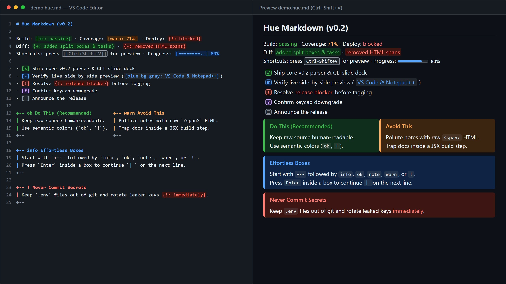
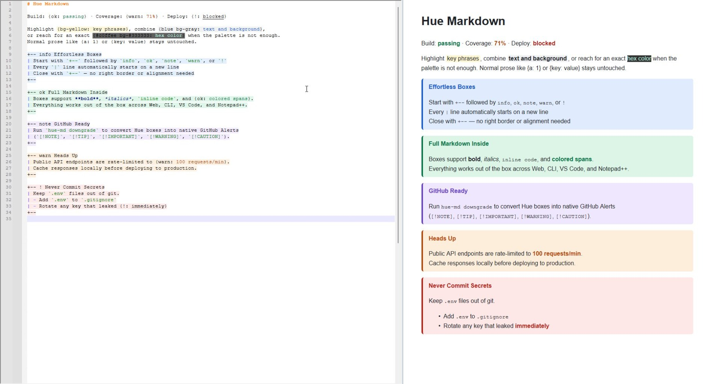
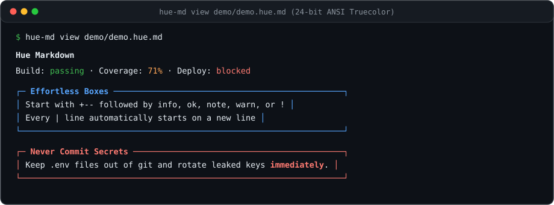

# Hue MD (`.hue.md`)

> **Color and callout boxes for Markdown that still read gracefully as raw text.**

[](https://spingras.github.io/hue-md/)
[](https://www.npmjs.com/package/hue-md)
[](https://marketplace.visualstudio.com/items?itemName=spingras.hue-md)
[](LICENSE)
[](#built-for-real-world-reliability)
[](#open-source-commitment-foss)
[](#supporting-hue-md)

<p align="center">
  <a href="https://spingras.github.io/hue-md/">
    <picture>
      <source media="(prefers-color-scheme: dark)" srcset="assets/hero-dark.svg">
      <source media="(prefers-color-scheme: light)" srcset="assets/hero-light.svg">
      
    </picture>
  </a>
</p>

<p align="center">
  <a href="https://spingras.github.io/hue-md/">
    
  </a>
</p>

---

## Why Hue MD?

Markdown won the world because its raw source already looks like what it means: `*italic*` looks emphasized and `# Title` looks like a heading before any parser touches it.

For over 20 years, however, Markdown has had **no clean, portable way to add color or draw a callout box**:
- **Raw HTML** (`<span style="color:red">`) ruins plain-text readability and gets stripped by GitHub and chat apps.
- **MDX / Components** (`<Callout type="warn">`) turns your notes into JavaScript trapped inside a build pipeline.
- **GitHub Alerts** (`> [!NOTE]`) have zero inline color and look like noisy bracket syntax in raw text.

**Hue MD (`hue-md`)** bridges this gap. You write clean, human-readable text that renders into rich color badges, highlights, and callout cards across your editors — and downgrades with one command into native GitHub Alerts when you share on GitHub.

---

## 1-Click Install

Grab the installer for your setup from the [**VS Code Marketplace**](https://marketplace.visualstudio.com/items?itemName=spingras.hue-md) or [**GitHub Releases**](https://github.com/spingras/hue-md/releases/latest):

| Platform | Status | Download | What It Does |
| :--- | :--- | :--- | :--- |
| 💻 **VS Code / Cursor / Windsurf** | ✅ Verified | [**VS Code Marketplace**](https://marketplace.visualstudio.com/items?itemName=spingras.hue-md) · [**`.vsix`**](https://github.com/spingras/hue-md/releases/latest/download/hue-md-0.1.1.vsix) | Search `Hue MD` (`spingras.hue-md`) in VS Code Extensions. Type `info`, `ok`, `note`, `warn` + <kbd>Tab</kbd> for boxes, live preview (`Ctrl+Shift+V`), and editor coloring. |
| 📦 **npm CLI & JS Package** | ✅ Verified | [**`npm i -g hue-md`**](https://www.npmjs.com/package/hue-md) | Terminal 24-bit ANSI viewer (`hue-md view`), GitHub Alert downgrade (`hue-md downgrade`), HTML exporter (`hue-md html`), and `markdown-it` plugin. |
| 📝 **Notepad++ (Windows x64)** | ✅ Verified | [**`hue-md-npp-x64.zip`**](https://github.com/spingras/hue-md/releases/latest/download/hue-md-npp-x64.zip) | Native `hue-md.dll` plugin with a docked side-by-side Live Preview (`Ctrl+Shift+H`), editor coloring, and 1-click box menu actions. |
| 🎨 **Web Stylesheet** | ✅ Verified | [**`hue-md.css`**](https://github.com/spingras/hue-md/releases/latest/download/hue-md.css) | Drop-in light & dark mode CSS stylesheet for any website or docs site. |
| 💎 **Obsidian Plugin** | 🧪 Preview | [**`hue-md-obsidian.zip`**](https://github.com/spingras/hue-md/releases/latest/download/hue-md-obsidian.zip) | Obsidian plugin (`manifest.json`, `main.js`, `styles.css`) for rendering Hue spans and boxes in your vault + Command Palette box insertion. |
| 🌙 **Neovim Plugin (`hue-md.nvim`)** | 🧪 Preview | [**`hue-md-nvim.zip`**](https://github.com/spingras/hue-md/releases/latest/download/hue-md-nvim.zip) | Lua plugin with extmark coloring, `:HueBox` command, and automatic `\| ` continuation on <kbd>Enter</kbd>. |
| 🐙 **GitHub.com (UserScript)** | 🧪 Preview | [**`hue-md.user.js`**](https://github.com/spingras/hue-md/releases/latest/download/hue-md.user.js) | Tampermonkey / Violentmonkey script — renders `.hue.md` spans and boxes on `github.com`. |
| 🌐 **Chrome / Edge / Brave Extension** | 🧪 Preview | [**`hue-md-browser.zip`**](https://github.com/spingras/hue-md/releases/latest/download/hue-md-browser.zip) | Chromium Manifest V3 extension (`Load unpacked`) for live Hue rendering on GitHub. |
| ⌨️ **Sublime & Emacs Pack** | 🧪 Preview | [**`hue-md-snippets.zip`**](https://github.com/spingras/hue-md/releases/latest/download/hue-md-snippets.zip) | Drop-in snippets (`info`, `ok`, `note`, `warn`, `danger`) + `hue-md-mode.el` for Emacs. |

---

## Syntax in 60 Seconds

### 1. Effortless Callout Boxes
You only need to choose **`info`**, **`ok`**, **`note`**, **`warn`**, or **`!`**:

<p align="center">
  <picture>
    <source media="(prefers-color-scheme: dark)" srcset="assets/boxes-dark.svg">
    <source media="(prefers-color-scheme: light)" srcset="assets/boxes-light.svg">
    
  </picture>
</p>

**What you write in `.hue.md`:**
```markdown
+-- info Effortless Boxes
| Start with `+--` followed by `info`, `ok`, `note`, `warn`, or `!`
| Every `|` line automatically starts on a new line
| Close with `+--` — no right border or alignment needed
+--

+-- ok Full Markdown Inside
| Boxes support **bold**, *italics*, `inline code`, and {ok: colored spans}.
| Everything works out of the box across Web, CLI, VS Code, and Notepad++.
+--

+-- note GitHub Ready
| Run `hue-md downgrade` to convert Hue boxes into native GitHub Alerts
| (`[!NOTE]`, `[!TIP]`, `[!IMPORTANT]`, `[!WARNING]`, `[!CAUTION]`).
+--

+-- warn Heads Up
| Public API endpoints are rate-limited to {warn: 100 requests/min}.
| Cache responses locally before deploying to production.
+--

+-- ! Never Commit Secrets
| Keep `.env` files out of git.
| - Add `.env` to `.gitignore`
| - Rotate any key that leaked {!: immediately}
+--
```

**What `hue-md downgrade` outputs for native GitHub rendering (all 5 boxes above, rendered live by GitHub below):**

> [!NOTE]
> **Effortless Boxes**
>
> Start with `+--` followed by `info`, `ok`, `note`, `warn`, or `!`  
> Every `|` line automatically starts on a new line  
> Close with `+--` — no right border or alignment needed

> [!TIP]
> **Full Markdown Inside**
>
> Boxes support **bold**, *italics*, `inline code`, and colored spans.  
> Everything works out of the box across Web, CLI, VS Code, and Notepad++.

> [!IMPORTANT]
> **GitHub Ready**
>
> Run `hue-md downgrade` to convert Hue boxes into native GitHub Alerts  
> (`[!NOTE]`, `[!TIP]`, `[!IMPORTANT]`, `[!WARNING]`, `[!CAUTION]`).

> [!WARNING]
> **Heads Up**
>
> Public API endpoints are rate-limited to **100 requests/min**.  
> Cache responses locally before deploying to production.

> [!CAUTION]
> **Never Commit Secrets**
>
> Keep `.env` files out of git.
> - Add `.env` to `.gitignore`
> - Rotate any key that leaked **immediately**

*(Want a 4-sided box in plain text? Closed ASCII `+-- ... --+`, Unicode `┌─ ... ─┐`, and rounded `╭─ ... ─╮` borders work too.)*

### 2. Inline Color & Highlights
Wrap any phrase in `{style: text}`:

- **Semantic status**: `{ok: passing}`, `{info: beta}`, `{note: v2.0}`, `{warn: 71%}`, `{!: blocked}`
- **7 palette colors**: `{red: ...}`, `{orange: ...}`, `{yellow: ...}`, `{green: ...}`, `{blue: ...}`, `{purple: ...}`, `{gray: ...}`
- **Background highlights**: `{bg-yellow: review this}`, `{blue bg-gray: badge}`
- **Exact Hex colors**: `{#c0ffee bg-#333333: custom hex}`

---

## Side-by-Side in VS Code, Notepad++ & Terminal

### VS Code Side-by-Side Live Preview (`Ctrl+Shift+V`)
<p align="center">
  
</p>

### Notepad++ Side-by-Side Live Preview (`Ctrl+Shift+H`)
<p align="center">
  
</p>

### Terminal Truecolor Viewer (`hue-md view`)
<p align="center">
  
</p>

Install globally from npm (or run directly with `npx hue-md`):
```sh
npm install -g hue-md
```

Then run:
- **View in Terminal** (24-bit ANSI truecolor & box frames):
  ```sh
  hue-md view demo/demo.hue.md
  ```
- **Downgrade for GitHub** (converts `.hue.md` into GitHub Flavored Markdown with native `> [!NOTE]` alerts):
  ```sh
  hue-md downgrade demo/demo.hue.md -o README.md
  ```
- **Export Standalone HTML**:
  ```sh
  hue-md html demo/demo.hue.md --standalone -o index.html
  ```

---

## Built for Real-World Reliability

Hue MD was engineered so you can turn it on across all your Markdown files without ever worrying about broken prose or code:
- **Zero False Positives**: JSON snippets (`{"key": "value"}`), object literals (`{a: 1}`), set/math notation (`$S = \{x : x > 0\}$`), and code blocks are never touched. Verified across 250+ real-world npm READMEs and AI transcripts with **0 unintended changes**.
- **100% CommonMark Superset**: All 652/652 CommonMark 0.31.2 spec examples render identically byte-for-byte.
- **Accessible by Default**: All 7 colors are tuned for strict WCAG AA contrast (4.5:1+) in both Light and Dark themes.
- **Linear Performance**: One-pass brace matching; 20,000 unclosed adversarial braces parse in under 20ms.

---

## For Developers & Integrators

Install the unified `hue-md` package from npm:
```sh
npm install hue-md markdown-it
```

```js
import MarkdownIt from 'markdown-it'
import hue, { css } from 'hue-md'
import { downgrade } from 'hue-md/downgrade'
import { renderAnsi } from 'hue-md/ansi'

// 1. Render Hue Markdown to HTML
const md = new MarkdownIt().use(hue)
const html = md.render('Build: {ok: passing}')
const stylesheet = css() // light + dark CSS custom properties

// 2. Downgrade .hue.md to GitHub Flavored Markdown (with > [!NOTE] alerts)
const gfm = downgrade(sourceText)

// 3. Render 24-bit ANSI truecolor for terminals
const ansi = renderAnsi(sourceText, { width: 80, theme: 'dark' })
```

- **Language Specification**: [spec/spec.md](spec/spec.md) defines the grammar and 58 executable specification examples.
- **Run Conformance & Test Suite**:
  ```sh
  npm test
  ```

---

## Open Source Commitment (FOSS)

Hue MD is and will always remain **100% Free and Open Source Software ([MIT License](LICENSE))**.
- **Zero Telemetry**: No tracking, phone-home, or data collection.
- **Zero Vendor Lock-in**: Everything is standard plain text that you own forever.
- **Fork Friendly**: Embed it in your own editors, parsers, and static site generators.

### Supporting Hue MD
This project is entirely self-funded and community-driven. If Hue MD saves you time or enhances your documentation workflow, consider supporting independent development:
- ☕ **Ko-fi**: [ko-fi.com/hue_md](https://ko-fi.com/hue_md) (Buy me a coffee)
- 💖 **Patreon**: [patreon.com/hue_md](https://patreon.com/hue_md) (Monthly supporter)
- ⭐ **Star this repository** on [GitHub](https://github.com/spingras/hue-md) to help others discover it!
