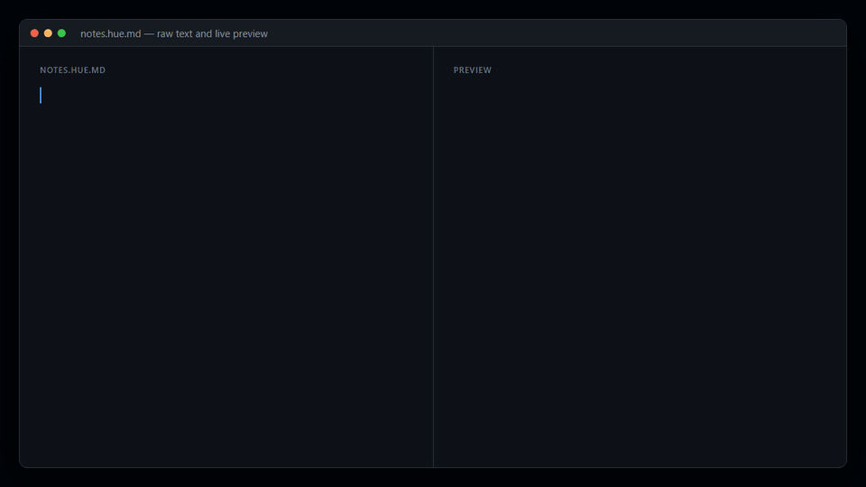
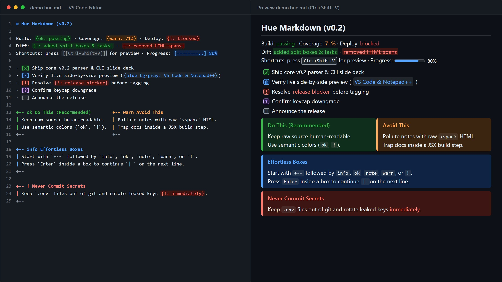

# Hue MD (`hue-md`) for Visual Studio Code

Hue MD adds color spans, diff spans, key caps, progress bars, multi-state tasks, and callout boxes (single or side-by-side) to Markdown (`.hue.md` and `.md`). You get a live side-by-side preview, editor highlighting, snippets, and 1-click GitHub Alert export.



[Interactive Playground](https://spingras.github.io/hue-md/) · [GitHub Repository](https://github.com/spingras/hue-md)



---

## What is new in v0.2

- Side-by-side split boxes: place two or more boxes on the same lines separated by at least two spaces to render equal-width columns with a 16 px gap.
- Multi-state tasks: use `- [ ]` (todo), `- [-]` (in progress), `- [!]` (blocked), `- [?]` (question), and `- [x]` (done).
- Native key caps: write `[[Ctrl+Shift+V]]`, `[[Cmd+K]]`, or `[[Esc]]` to render styled `<kbd>` badges.
- Progress bars: write `[========..] 80%` or `[==========] 100%` to render inline progress bars.
- Inline diff spans: write `{+: added text}` (green) and `{-: removed text}` (red strikethrough).

---

## Features

- Box and inline snippets: type `info`, `ok`, `note`, `warn`, `danger`, `split`, `diff`, `kbd`, `progress`, or `task` and press `Tab`.
- Line continuation inside boxes: press `Enter` inside a box to insert `| ` on the next line; press `Enter` on an empty `| ` line to close with `+--`.
- Live side-by-side preview (`Ctrl+Shift+V`): renders all Hue constructs with WCAG AA light and dark theme contrast.
- Editor syntax coloring and decorations: highlights Hue tokens, hex values, tasks, key caps, progress bars, diffs, and box borders in the editor.
- 1-click GitHub Alert export: run `Hue: Convert to GitHub Alert Markdown (.md)` to convert boxes and split boxes into native GitHub Alerts (`> [!NOTE]`, `> [!TIP]`, `> [!IMPORTANT]`, `> [!WARNING]`, `> [!CAUTION]`).

---

## Syntax Overview

```markdown
# Hue Markdown (v0.2)

Build: {ok: passing} · Coverage: {warn: 71%} · Deploy: {!: blocked}
Changelog: {+: added split-box columns}, {-: removed legacy fallback}
Shortcuts: press [[Ctrl+Shift+V]] to open preview · Progress: [========..] 80%

- [x] Ship core v0.2 parser
- [-] Verify VS Code live preview
- [!] Resolve blocker before release
- [?] Confirm keycap downgrade format
- [ ] Tag release

+-- ok Do This (Recommended)        +-- warn Avoid This
| Keep raw source human-readable.   | Pollute notes with raw `<span>` HTML.
| Use semantic colors (`ok`, `!`).  | Trap docs inside a JSX build step.
+--                                 +--

+-- info Open Boxes
| Start with `+--` followed by `info`, `ok`, `note`, `warn`, or `!`
| Every `|` line starts on a new line
| Close with `+--` without a right border
+--
```

---

## Commands (`Ctrl+Shift+P` / `Cmd+Shift+P`)

- `Hue: Open Side-by-Side Preview`: split editor with live rendered preview
- `Hue: Insert Box...`: pick `info`, `ok`, `note`, `warn`, or `!` from a quick menu
- `Hue: Wrap Selection in Box...`: wrap selected lines in a Hue box
- `Hue: Convert to GitHub Alert Markdown (.md)`: convert `.hue.md` to GitHub Flavored Markdown

---

## Support Hue MD (MIT License)

- Ko-fi: [ko-fi.com/hue_md](https://ko-fi.com/hue_md)
- Patreon: [patreon.com/hue_md](https://patreon.com/hue_md)
- GitHub: [github.com/spingras/hue-md](https://github.com/spingras/hue-md)
