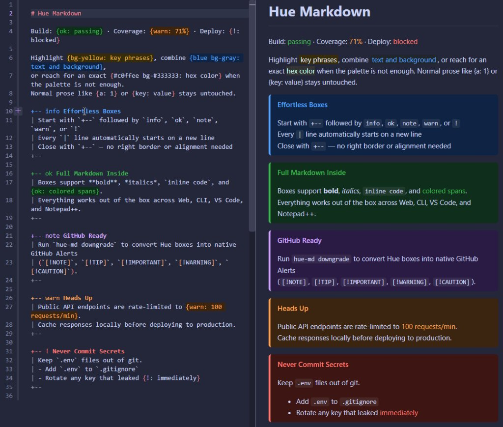

# Hue MD (`hue-md`) for Visual Studio Code

> **Color and callout boxes for Markdown that still read gracefully as raw text.**

**Hue MD** brings inline color spans (`{ok: passing}`, `{warn: 71%}`, `{!: blocked}`) and effortless callout boxes (`+-- info`, `ok`, `note`, `warn`, `!`) to Markdown (`.hue.md` and `.md`) with live side-by-side preview, instant snippets, and 1-click GitHub Alert export.



[**Live Interactive Playground → spingras.github.io/hue-md**](https://spingras.github.io/hue-md/) · [**GitHub Repository**](https://github.com/spingras/hue-md)

---

## Features

- ⚡ **Instant Box Snippets**: Type `info`, `ok`, `note`, `warn`, or `danger` and press <kbd>Tab</kbd> to insert a callout box.
- ↩️ **Effortless Line Continuation**: Press <kbd>Enter</kbd> inside a box to automatically insert `| ` on the next line; press <kbd>Enter</kbd> on an empty `| ` line to close with `+--`.
- 🎨 **Live Side-by-Side Preview (`Ctrl+Shift+V`)**: Renders inline color spans, background highlights, and callout boxes with WCAG AA light & dark theme contrast.
- 🖋️ **Editor Syntax Coloring & Decorations**: Highlights Hue tokens, hex values, and box borders directly inside the editor.
- 🔄 **1-Click GitHub Alert Export**: Run `Hue: Convert to GitHub Alert Markdown (.md)` to compile boxes into native GitHub Alerts (`> [!NOTE]`, `> [!TIP]`, `> [!IMPORTANT]`, `> [!WARNING]`, `> [!CAUTION]`).

---

## Syntax in 60 Seconds

```markdown
# Hue Markdown

Build: {ok: passing} · Coverage: {warn: 71%} · Deploy: {!: blocked}

Highlight {bg-yellow: key phrases}, combine {blue bg-gray: text and background},
or reach for an exact {#c0ffee bg-#333333: hex color} when the palette is not enough.
Normal prose like {a: 1} or {key: value} stays untouched.

+-- info Effortless Boxes
| Start with `+--` followed by `info`, `ok`, `note`, `warn`, or `!`
| Every `|` line automatically starts on a new line
| Close with `+--` — no right border or alignment needed
+--

+-- ! Never Commit Secrets
| Keep `.env` files out of git.
| - Add `.env` to `.gitignore`
| - Rotate any key that leaked {!: immediately}
+--
```

---

## Commands (`Ctrl+Shift+P` / `Cmd+Shift+P`)

- **`Hue: Open Side-by-Side Preview`**: Split editor with live rendered preview
- **`Hue: Insert Box...`**: Pick `info`, `ok`, `note`, `warn`, or `!` from a quick menu
- **`Hue: Wrap Selection in Box...`**: Wrap selected lines in a Hue callout box
- **`Hue: Convert to GitHub Alert Markdown (.md)`**: Convert `.hue.md` to GitHub Flavored Markdown

---

## Supporting Hue MD (100% FOSS · MIT)

- ☕ **Ko-fi**: [ko-fi.com/hue_md](https://ko-fi.com/hue_md)
- 💖 **Patreon**: [patreon.com/hue_md](https://patreon.com/hue_md)
- ⭐ **GitHub**: [github.com/spingras/hue-md](https://github.com/spingras/hue-md)
